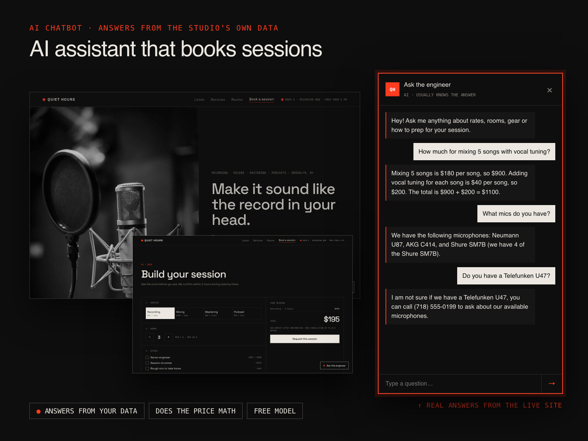

# Quiet Hours — Recording Studio Website with an AI Chatbot

A minimal, dark landing page for a (fictional) Brooklyn recording studio with a built-in **AI assistant** that answers visitors' questions from the studio's own data and guides them to book.

**Live demo:** https://woaquw.github.io/quiet-hours-studio/



## What makes it stand out

- **AI chatbot "Ask the engineer".** Opens from the hero button or the floating button (with a teaser bubble). Answers questions about rates, rooms, gear and session prep from the studio's own facts, does price math ("5 songs with vocal tuning" → $1,100) and points people to the booking section. Runs on a free open-source model (Llama 3.3 on Cloudflare Workers AI). Worker code: [ai-site-assistant](https://github.com/woaquw/ai-site-assistant).
- **"Raw vs Our mix" player.** A short track is synthesized live with the Web Audio API and played through two processing chains at once: an unmixed one (muddy, unbalanced, mono) and a mixed one (EQ, balance, stereo width, reverb, bus compression, limiter). One click (or the `M` key) flips between them instantly, in sync, with a live spectrum visualizer. No audio files, no licensing issues.
- **Session builder.** Pick a service, hours or songs, extras (senior engineer, vocal tuning, rush delivery…), a day and a free start time; the price updates live, then the request is sent with a full summary.
- **Live room status** in the header ("Room A · recording now · free from 6 pm"), calculated in studio time (New York).

## Also

- Minimal design system: one accent color, monospace details, hairline borders, grayscale photos that come to life on hover; service photos follow the cursor.
- Responsive (phone, tablet, desktop), keyboard friendly, respects "reduce motion".
- Plain HTML, CSS and JavaScript. No frameworks, no build step.
- The form works in demo mode or sends JSON to any form backend via `data-endpoint`.

## Run locally

```bash
python3 -m http.server 8000
```

Photos from [Unsplash](https://unsplash.com). The studio, prices, people and reviews are fictional; this is a portfolio project.
